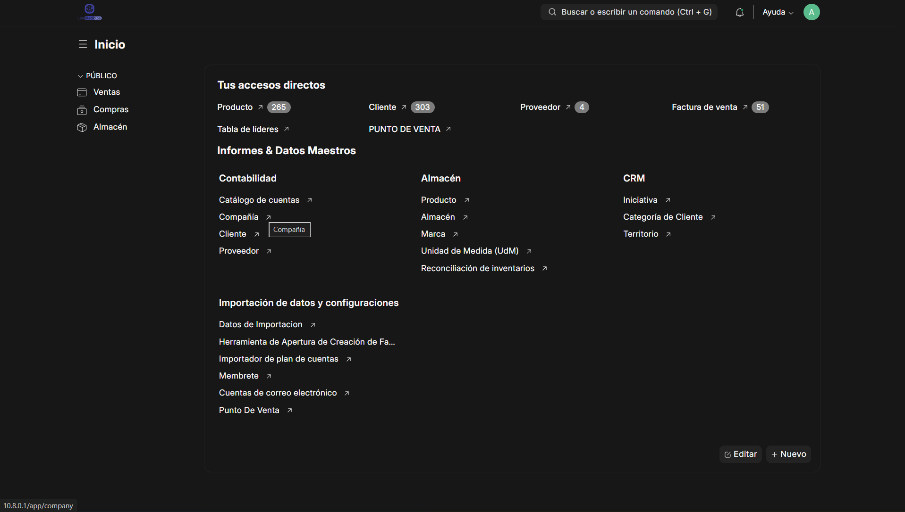
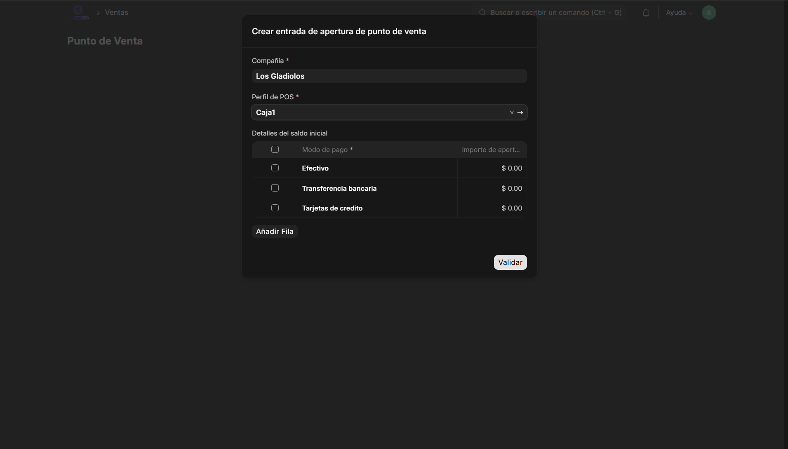
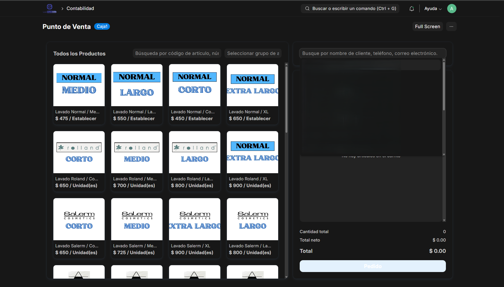
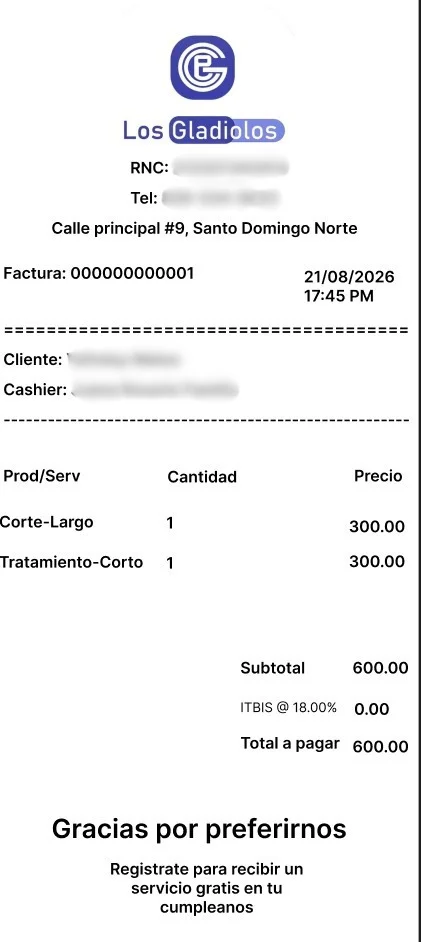

  ### atlas-billing

[](https://github.com/LenielMojica/atlas-billing/actions/workflows/ci.yml)
[](https://github.com/LenielMojica/atlas-billing/actions/workflows/linter.yml)
[](LICENSE)
[](https://frappeframework.com/)

A point-of-sale and billing system for a hair salon in the Dominican Republic, built as a custom [Frappe](https://frappeframework.com/) app on top of [ERPNext](https://erpnext.com/). It replaced the salon's handwritten register and Excel sheets and is used daily at checkout.
 
Rather than rebuilding invoicing or accounting, Atlas Billing is a thin layer over ERPNext's Selling, Accounting, and POS modules. It adds the salon's business rules, custom fields, staff roles, reports, and a receipt format.
## Screenshots
| **Home** | **POS Opening Entry** |
|:---:|:---:|
|  |  |
| **POS** | **Receipt** |
|   |  |
### Installation

You can install this app using the [bench](https://github.com/frappe/bench) CLI:

```bash
cd $PATH_TO_YOUR_BENCH
bench get-app $URL_OF_THIS_REPO --branch main
bench install-app atlas_billing
```

## Tech stack
 
| Area | Tools |
|------|-------|
| Framework | Frappe v15, ERPNext v15 |
| Languages | Python, JavaScript, SQL, Jinja |
| Database | MariaDB |
| Testing & CI | Frappe test runner, GitHub Actions |
| Code quality | Ruff, ESLint, Prettier, Semgrep, pip-audit (via pre-commit) |
| Deployment | Ubuntu, Nginx, Supervisor, UFW, WireGuard |
 
## Installation
 
Requires a [bench](https://github.com/frappe/bench) with Frappe and ERPNext v15.
 
1. Create a site with ERPNext and **complete the Setup Wizard in the browser first** (company, country, currency). The app's install step needs the company, chart of accounts, and item groups that the wizard creates.
2. Install the app:
```bash
   bench get-app https://github.com/LenielMojica/atlas-billing --branch main
   bench --site <your-site> install-app atlas_billing
```
 
   If the app was installed before the Setup Wizard ran and its setup didn't complete, run the install again with `--force`:
 
```bash
   bench --site <your-site> install-app atlas_billing --force
```
 
## Post-install setup
 
Some settings depend on data that only exists on a real site (company, warehouse, chart of accounts, branding), so they can't ship as fixtures. Configure them once per site:
 
- **Item Groups → Item Category and Group code.** Mark your service groups as `Service` and product groups as `Product`, and give each group a short code. Tax templates, the services-can't-be-stock rule, and item codes all depend on these.
- **ITBIS account.** The ITBIS-exempt tax template is created automatically when an account named `ITBIS` exists in the chart of accounts.
- **POS Profile → Allow Partial Payment.** Enable it on every POS Profile used at checkout; otherwise sales on credit are rejected.
- **POS Profile → Print Format.** Select the app's receipt format. The POS screens read the format from the POS Profile, not from the DocType's default, so without this no format is available when printing from the POS.
- **POS Profile → Warehouse.** Required by ERPNext. The default warehouse from the Setup Wizard is fine; it only matters for retail products, since services are non-stock.
- **Letter Head.** Create one with the salon's logo and mark it **Is Default**, or receipts print with a blank header. It's not a fixture because the logo is specific to each client.
- **Hide unused Workspaces.** From the sidebar's edit mode, hide modules the salon doesn't use (Assets, Manufacturing, Projects, Quality, CRM, Support, Website, Integrations, and similar). This can't be a fixture: Frappe's fixture sync deliberately ignores `Workspace.is_hidden` (`ignore_values` in `frappe/modules/import_file.py`).
## Testing
 
The suite has unit tests for the validation rules (fast, using mocks, no database) and integration tests that create real items and invoices to check the reports and tax templates.
 
```bash
bench --site <test-site> set-config allow_tests true
bench --site <test-site> run-tests --app atlas_billing
```
 
## CI
 
GitHub Actions runs on every pull request:
 
- **CI:** installs Frappe, ERPNext, and the app on a fresh site, then runs the test suite.
- **Linters:** pre-commit hooks, [Frappe Semgrep rules](https://github.com/frappe/semgrep-rules), and [pip-audit](https://pypi.org/project/pip-audit/) for vulnerable dependencies.
## Deployment
 
The production site runs on an Ubuntu VPS using `bench setup production`: Nginx serves static files and proxies the app, and Supervisor keeps its processes running and restarts them on failure. The firewall (UFW) only accepts web traffic from a WireGuard VPN, so the app is reachable only from the salon's own devices.
 
## Roadmap
 
- Classify sales in both reports by the Item Category flag instead of the item group's name, so they work on sites set up in any language.
## Contributing
 
This app uses [pre-commit](https://pre-commit.com/) for formatting and linting (Ruff, ESLint, Prettier):
 
```bash
cd apps/atlas_billing
pre-commit install
```
 
## Acknowledgments
 
Built on [Frappe](https://frappeframework.com/) and [ERPNext](https://erpnext.com/). Development, debugging, and server setup were done with the help of [Claude Code](https://claude.com/claude-code) (Anthropic).
 
## License
 
[MIT](LICENSE)
